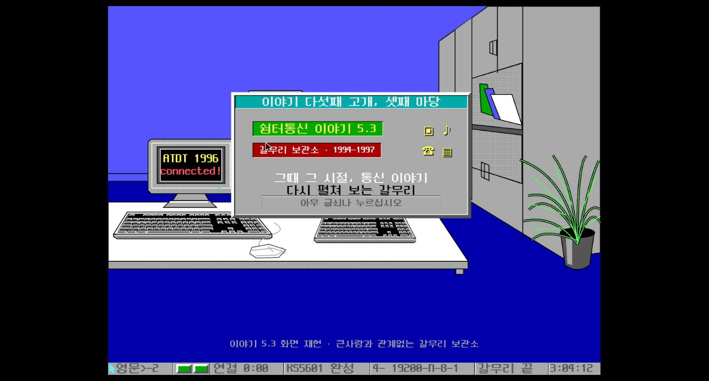
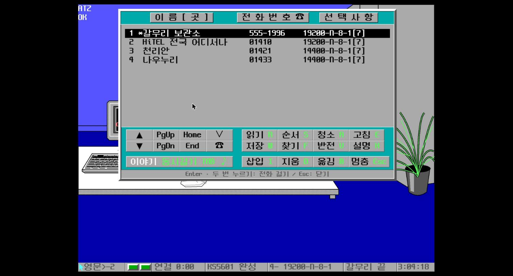
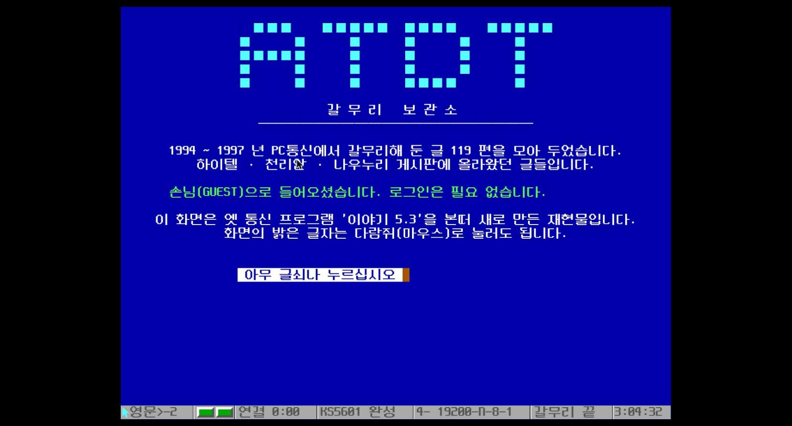
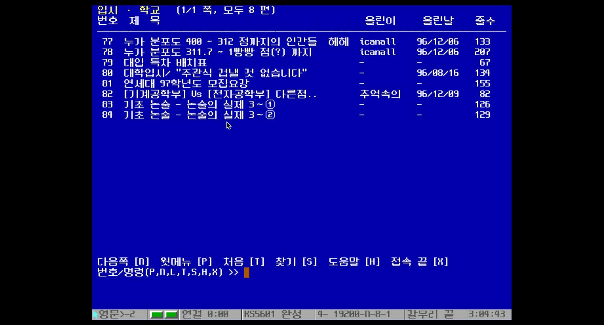
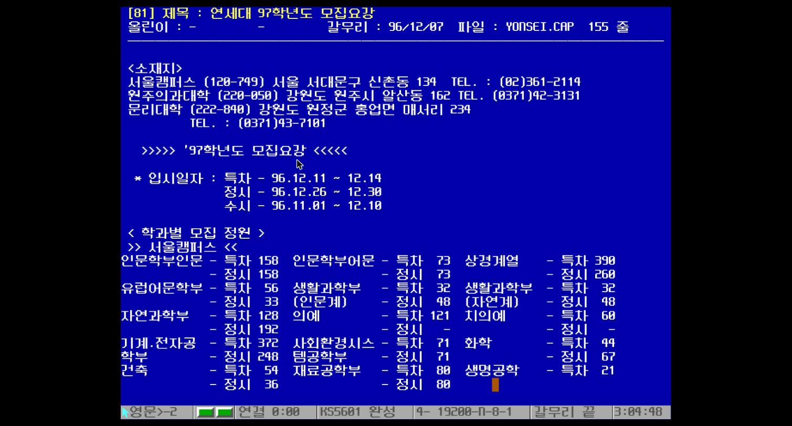
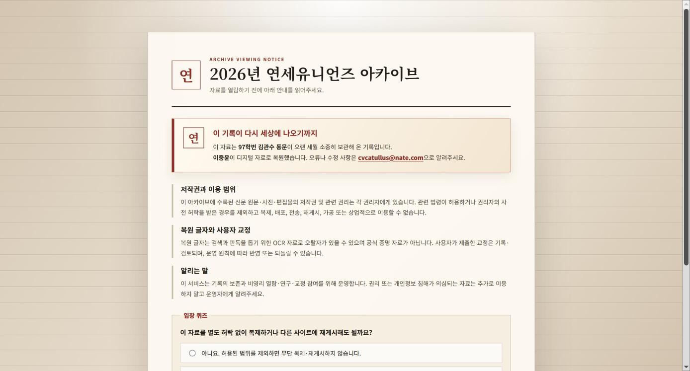
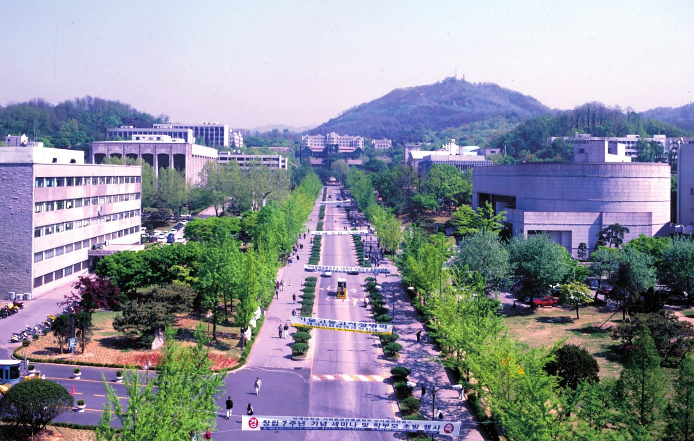
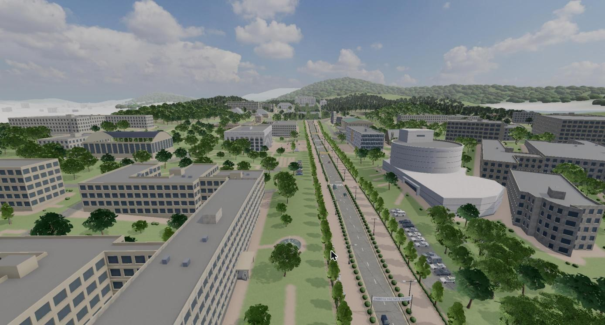
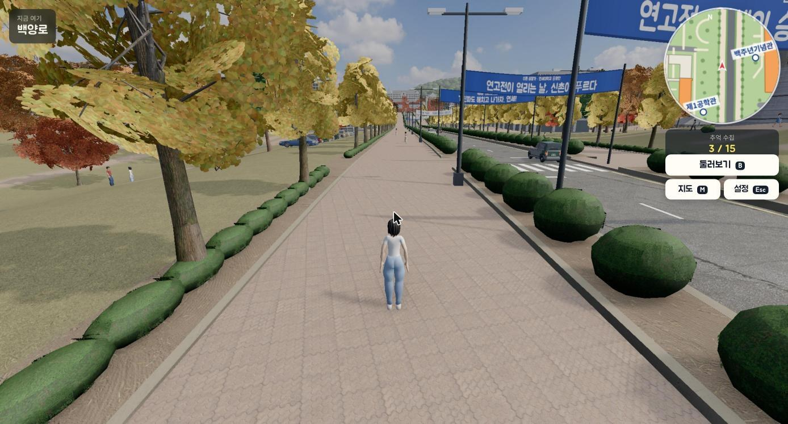
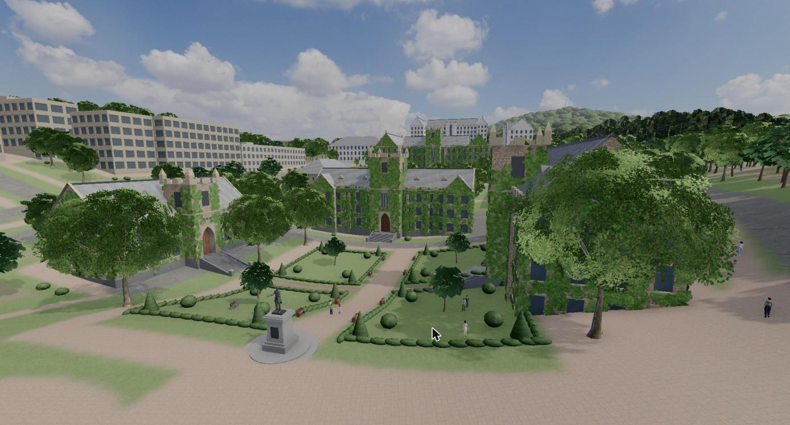

# 추억 저장소

그 시절의 PC통신, 합격자 명단, 캠퍼스를 다시 만나볼 수 있는 세 곳을 소개합니다.

## 1. 1997년 모집요강

<a href="http://atdt.benelog.net/" target="_blank">http://atdt.benelog.net/</a>

1994~1997년 하이텔·천리안·나우누리 게시판에 올라왔던 글 119편을 모아 둔 곳입니다. 옛 통신 프로그램 '이야기 5.3'의 화면을 그대로 재현해, 접속부터 게시판 탐색까지 그 시절 방식으로 체험할 수 있습니다.

### 접속해서 '연세대 97학년도 모집요강'까지 찾아가기

<ol class="memory-steps">
<li>

<strong>시작 화면</strong>: 사이트에 들어가면 DOS가 부팅되고 '이야기 5.3' 화면이 나타납니다. 아무 키나 누르거나 화면을 누르세요.

</li>
<li>

<strong>전화 걸기</strong>: 전화번호부에서 <code>1 갈무리 보관소 (555-1996)</code>가 선택된 상태로 <code>Enter</code>를 누르면 접속합니다.

</li>
<li>

<strong>접속 완료</strong>: 손님(GUEST)으로 입장하며 로그인은 필요 없습니다. 아무 키나 누르면 주메뉴로 넘어갑니다.

</li>
<li>

<strong>주메뉴에서 6번 선택</strong>: <code>6</code>을 입력하고 <code>Enter</code>를 누르면 '입시 · 학교' 게시판으로 들어갑니다.

</li>
<li>

<strong>게시글 81번 열기</strong>: 목록에서 <code>81</code> '연세대 97학년도 모집요강'을 입력하고 <code>Enter</code>를 누릅니다.

</li>
<li>

<strong>도착</strong>: 주소가 <a href="https://atdt.benelog.net/#YONSEI" target="_blank">https://atdt.benelog.net/#YONSEI</a>로 바뀌며 1996년 12월에 갈무리된 97학년도 모집요강이 열립니다. 이 주소로 바로 들어가도 됩니다.

</li>
</ol>

## 2. 1997년 합격자 명단

<a href="https://yonsei-unions-archive.vercel.app/" target="_blank">https://yonsei-unions-archive.vercel.app/</a>

97학번 김관수 동문이 오랜 세월 보관해 온 신문 기록을 이중윤 동문이 디지털 자료로 복원한 아카이브입니다. 당시 한국대학신문에 실린 97학년도 합격자 명단을 쪽별로 넘겨 보고, 이름이나 수험번호로 검색할 수 있습니다. 위 화면은 신문의 마지막 쪽인 11쪽, '연세대 97학년도 합격자 명단'입니다.

* 입장 전에 저작권과 이용 범위에 관한 안내를 읽고, 입장 퀴즈에 답한 뒤 동의해야 합니다.
* 신문 쪽의 글자 위에 마우스를 올리면 수험번호와 이름이 표시됩니다.
* 복원된 글자는 OCR 자료라 오탈자가 있을 수 있으며, 오류나 수정 사항은 안내된 이메일로 알려주시면 됩니다.

## 3. 1997년 신촌 캠퍼스 산책

<a href="https://yonsei-1997.benelog.net/" target="_blank">https://yonsei-1997.benelog.net/</a>

1997년 5월의 신촌캠퍼스를 정문에서 백양로를 따라 걸어 볼 수 있는 3D 산책 게임입니다. 중앙도서관, 학생회관, 노천극장, 언더우드관 등을 돌아보며 그 시절 사진과 이야기가 담긴 '추억 카드'를 열고 스탬프를 모을 수 있습니다.

* 4월 벚꽃, 5월 신록, 10월 은행잎 중 계절을 고를 수 있고, 10월에는 연고전 응원 현수막이 걸립니다.
* 하늘에서 내려다보는 '캠퍼스 둘러보기(버드 아이뷰)'를 지원합니다.
* PC에서는 방향키(또는 W·A·S·D)로 걷고, 모바일에서는 화면의 조이스틱으로 움직입니다.
